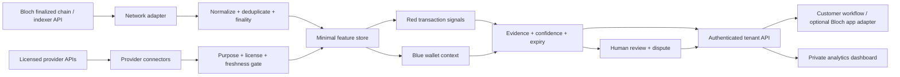

# External service architecture

The adapter is read-only. It must wait for the configured chain finality threshold, tolerate reorganizations, key records by `(chain_id, network, asset_id, tx_id)`, and retain source timestamps. Vendor evidence is stored separately from public chain observations. Identity mapping, if legally justified, belongs in a more restricted encrypted store and is never required for a chain address score.

No validator, mempool, block header, state root, protocol governance, or on-chain sanction list depends on BI-PoRB. If the service is unavailable, Bloch continues to operate.

## Source material assessment

The user-supplied `DESIGN.md`, `architecture.svg`, and `bloch-pobrs.zip` describe an oracle-free scoring engine inside consensus. That direction is superseded for this product. The Rust prototype passed 25 tests in an isolated review, but it lacks persistence, reorg handling, asset isolation, external source provenance, and production validation. It also has no supplied license; this repository does not redistribute its source. Reuse requires a separate code review and licensing decision. Its simulated learning curve is displayed only as research data.
