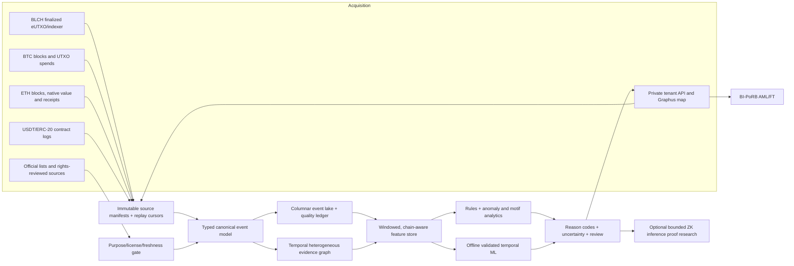

# Graphus 2.0: deep initial-asset intelligence architecture

**Product:** Graphus of Bloch Inc — A Matter of Data 2.0. **Initial assets:** BTC, ETH, USDT (ERC-20), USDC (ERC-20), BLCH on three networks. Solana is later-phase research. **Status:** design and small verified components, not a production data lake or model. Graphus is an off-chain private platform; BI-PoRB is its first AML/FT application.

## The graph map

Every element must support event time, ingestion time, source version, chain/network/asset identity, finality or confirmation policy, rollback state, and lineage. A chain-height health check is not an event dataset; the current ETH/BTC jobs ingest zero transactions. Bloch has two separate private, snapshot-pinned research samples of 400 and 495 finalized transactions. Neither bounded sample is a live feed or a coverage claim.

## Canonical data and source semantics

| Network | Base facts | Critical distinction | First replay gate |
| --- | --- | --- | --- |
| BTC | blocks, transactions, inputs, UTXOs, outpoints, scripts, spends | Multi-input transactions have no singular sender; change, CoinJoin, and common-input ownership are hypotheses | Reconstruct spent outpoints from a local node or licensed history; compare block hashes and undo reorgs |
| ETH | blocks, native value, transaction receipts, contract calls, traces where available | Native ETH value, internal calls, and user intent are different; a service address may custody many users | Resolve chain ID and finalized block hash; require matching successful receipt and replay reorgs |
| USDT/USDC on Ethereum | issuer-published contract identities, successful ERC-20 `Transfer` logs | Contract address defines asset identity; mint/burn and arbitrary contract calls are separate event types | Deduplicate `(tx_hash, log_index, contract)` and replay removed logs; recheck issuer registry |
| BLCH | finalized indexed eUTXO transactions, inputs/outputs, script hashes, slot/block identity, asset units | A script hash does not identify a person; carryover and asset identity require explicit lineage | Reconcile indexer status with node finality, full input/output values, and state/block root |

Use exact integer units per asset, explicit decimals and valuation timestamp when displaying fiat equivalents. Do not collapse bridge mappings, wrapped assets, native assets, and chain-specific token programs into a single address edge. Cross-chain value flow requires a verifiable source transaction, bridge message, destination receipt, and asset mapping. Otherwise it is a time correlation hypothesis, not a flow edge.

## Heterogeneous temporal graph

**Nodes:** transaction, block/slot, BTC outpoint, UTXO script, EVM account/contract, ERC-20 contract and asset, BLCH output/script, bridge message, source record, claim, case. **Edges:** spends, creates, emits log, calls contract, transfers token, maps bridge receipt, appears in source, reviewed association. An edge includes `valid_from`, `valid_until`, `observed_at`, `ingested_at`, source, confidence, proof reference, tenant visibility, and deletion/rollback version. Avoid a permanent wallet-to-person edge from heuristics. The Solana account/program model remains a later-phase extension.

The graph map should expose a time slider, typed edge filters, direction/amount/asset filters, path limit, shared-service hub warnings, source card, finality, evidence strength, and alternative explanations. It must visually separate **observation**, **official exact match**, **third-party attribution**, **community allegation**, **model hypothesis**, and **human decision**. Public address search and lawful chain/ML details are planned, while private cases and scores require tenant authorization and audit logging. Public features require source-rights and data-protection review and must not trivially reveal the protected score.

## Deep analytics engine

1. **Deterministic features:** bounded time-window fan-in/out, velocity, dwell time, pass-through, peel-chain candidate, cyclic flow, asset conversion, concentration, burstiness, repeated micro-transfers, bridge round trips, source freshness, and graph degree/hub status. Features carry applicability and missingness; a missing trace is not zero activity.
2. **Path and motif search:** event-time ordered, direction-aware traversal with asset/value constraints, expiry, and degree-aware penalties. The [Atlas implementation](graphus-data-atlas.md) now provides bounded temporal paths, return cycles, incoming/outgoing pairs, UTC fan windows and repeated directed pairs against public captures and verified private analyses. It retains exact events, source coverage, query limits and reproducible digests without making ownership assertions. Ordered queries require increasing block timestamps and heights; high-degree references have structural caveats. Degree-aware scoring penalties and evaluation beyond bounded samples remain research work.
3. **Anomaly analysis:** per-chain and per-asset baselines, robust change-point signals, seasonality, peer-group comparison, and uncertainty bands. Unsupervised anomalies are review leads, not illicit labels.
4. **Temporal ML research:** test temporal graph embeddings/TGN-style models against transparent rules and simpler tabular baselines. Self-supervised pretraining may use lawful public structure, but supervised outcomes require independent reviewed cases. Use time and entity disjoint test sets, no future features, no neighborhood label leakage, calibration, precision at review capacity, false-positive burden, and drift/adversarial tests. More raw data alone does not guarantee precision.
5. **Active review loop:** prioritize informative borderline cases for analysts, record reasons, appeals, corrections, and independent review. Keep unverified allegations out of ground truth. Retraining is a controlled release with reproducible feature/model manifests and rollback.
6. **ZK computation:** benchmark a small deterministic feature calculation or model inference against committed inputs and pinned model/circuit hashes. Proof validity shows calculation integrity under the stated circuit; it does not attest source truth, legal entitlement, calibration, or guilt. Full private graph training is outside the first ZK scope.

## Practical two-server build

| Host | First durable workload | Later workload after gates |
| --- | --- | --- |
| Data host, former DEX | Current OFAC snapshot, Bloch sample, ETH/BTC height probes; private status and source manifests | Bounded BTC, ETH, USDT/USDC and BLCH ingestion, compressed event partitions, replay cursors, source quality, encrypted backup |
| Graphus host, former Bridge | Current graph prototype and offline parser validation; private workspace | Columnar feature windows, temporal graph adjacency, offline models, ZK benchmark and verifier artifacts |
| L2 host | Reserved for L2 | No Graphus workload |

Start with local encrypted partitions and measured replay throughput. Consider Parquet/Iceberg-style snapshots for reproducible event history and deletion, a columnar query layer for time-window analytics, and a graph adjacency index for bounded traversals. Select concrete engines by a benchmark of ingest rate, reorg recovery, 3 TB disk budget, query latency, backup/restore, deletion, licensing, and operational load; do not install a large database merely to appear advanced. The two hosts do not provide high availability by themselves. Ethereum full archive needs a separate capacity and source decision; Solana is outside the first-wave plan.

## Release gates and measures

| Gate | Evidence required |
| --- | --- |
| Source trust | Official node or rights-reviewed endpoint, source manifest, checksum, freshness, finality and reorg behavior |
| Data quality | Per-chain reconciliation, missing-block accounting, schema-version tests, deduplication and replay |
| Privacy | Purpose/legal basis, field inventory, retention/deletion, tenant separation, DPIA/RIPD and transfer assessment where applicable |
| Graph quality | Edge-type validation, path reproducibility, hub/confounder review, correction propagation |
| ML quality | Held-out real labels, precision/recall/FPR, calibration and workload by chain, drift, independent sign-off |
| ZK quality | Pinned circuit/verifier key, proof test vectors, leakage analysis, CPU/RAM/time/cost benchmark |
| Service quality | Auth, audit, incident response, backup restore, human review and appeal, no automatic sanctions decision |

## Research and implementation references

- [Ethereum JSON-RPC](https://ethereum.org/developers/docs/apis/json-rpc/), [ERC-20 standard](https://eips.ethereum.org/EIPS/eip-20), [Tether USDT contract](https://tether.to/en/supported-protocols/), [Circle USDC contract](https://developers.circle.com/stablecoins/usdc-contract-addresses), [Bitcoin Core RPC](https://bitcoincore.org/en/doc/31.0.0/rpc/), and the Bloch indexer source referenced in [chain adapters](chain-adapters.md).
- [Temporal Graph Networks](https://arxiv.org/abs/2006.10637) is a research candidate for dynamic-event modeling, not evidence that it outperforms the rule baseline on these chains.
- [Apache Iceberg specification](https://iceberg.apache.org/spec/) documents snapshots and row-level deletes; an implementation still needs a tested privacy deletion lifecycle.
- [GraphSense Library](https://github.com/graphsense/graphsense-lib) is a possible open-source reference after source and license review.
- [SP1 repository](https://github.com/succinctlabs/sp1) is a potential proof toolchain subject to license, security, and performance validation.
